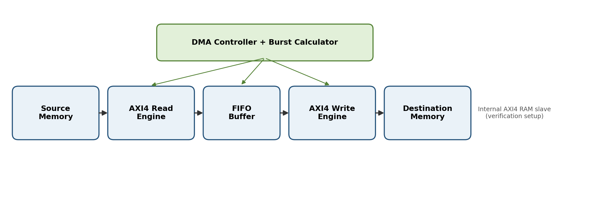

# AXI4 Master with Burst Transfer Support

<p align="center">
  
</p>

<p align="center">
  <strong>RTL Design | AXI4 Protocol | Burst Transactions | Verification</strong>
</p>

<p align="center">
  
  
  
  
</p>

<p align="center">
  <a href="https://github.com/Act-as-Harsha/VLSI-Design-Projects">
    
  </a>
  <a href="https://github.com/Act-as-Harsha">
    
  </a>
</p>

---

## 📌 Project Overview

**AXI4 Master with Burst Transfer Support** is a Verilog HDL project focused on understanding and developing an AXI4 Master interface using concepts from the ARM AMBA AXI4 protocol.

AXI4 (Advanced eXtensible Interface 4) is widely used in System-on-Chip (SoC) architectures to enable communication between processors, memory controllers, DMA engines, and other high-performance IP blocks.

This project brings together RTL design resources, simulation files, an architecture diagram, a project report, and presentation materials to support the study of AXI4 transactions and burst-transfer control.

## 🎯 Project Objectives

- Design and study an AXI4 Master interface using Verilog HDL.
- Understand the five independent AXI4 communication channels.
- Explore the `VALID`–`READY` handshake mechanism.
- Understand burst addressing, transfer length, and data-beat control.
- Study write-response and read-response handling.
- Simulate RTL and inspect waveforms using Xilinx Vivado.
- Document the architecture and verification workflow.

## 🧩 AXI4 Protocol Overview

AXI4 uses five independent channels to support read and write transactions.

| Channel | Direction from Master | Function |
|---|---|---|
| AW — Write Address | Master → Slave | Transfers the write address and transaction control information. |
| W — Write Data | Master → Slave | Transfers write data and identifies the final beat using `WLAST`. |
| B — Write Response | Slave → Master | Returns the write transaction status. |
| AR — Read Address | Master → Slave | Transfers the read address and transaction control information. |
| R — Read Data | Slave → Master | Returns read data and response information; `RLAST` identifies the final beat. |

### VALID–READY Handshake

An AXI4 transfer occurs on a rising clock edge when both `VALID` and `READY` are asserted.

```verilog
transfer = VALID && READY;
```

- `VALID`: The sender indicates that the address, data, or response is available.
- `READY`: The receiver indicates that it can accept the transfer.
- Transfer: The transaction beat is accepted when both signals are high at the sampling clock edge.

Each AXI4 channel performs its handshake independently.

### Important Burst Signals

| Signal | Description |
|---|---|
| `AWADDR` | Starting address of a write transaction |
| `ARADDR` | Starting address of a read transaction |
| `AWLEN` | Encoded number of write data beats minus one |
| `ARLEN` | Encoded number of read data beats minus one |
| `AWSIZE` | Encoded number of bytes per write data beat |
| `ARSIZE` | Encoded number of bytes per read data beat |
| `AWBURST` | Write burst type |
| `ARBURST` | Read burst type |
| `WLAST` | Indicates the final write data beat |
| `RLAST` | Indicates the final read data beat |

**Important:** AXI4 uses zero-based burst-length encoding.

For example, `AWLEN = 4` or `ARLEN = 4` represents a transaction containing **5 data beats**.

The number of bytes per beat is calculated as:

\[
\text{Bytes per beat} = 2^{\text{AxSIZE}}
\]

For example, `AWSIZE = 2` represents 4 bytes per write data beat.

## 🏗️ Architecture

The project includes an architecture diagram illustrating the AXI4/DMA-related design.

**Architecture diagram:** `axi4_dma_architecture_diagram.png`

The diagram is displayed at the top of this README when the image is stored in the repository root. If it is stored in another directory, update the image path accordingly.

At a conceptual level, an AXI4 Master initiates transactions by presenting address and control information, transfers or receives data through the appropriate channels, and completes transactions through response handling.

The exact module hierarchy, internal state machines, and supported transaction configurations should be confirmed from the RTL implementation.

## 🛠️ Tools and Technologies

| Technology | Purpose |
|---|---|
| Verilog HDL | RTL design and hardware description |
| Xilinx Vivado | RTL simulation, synthesis, and FPGA implementation workflow |
| Simulation Testbench | Functional verification of the design |
| Waveform Analysis | Inspection of handshakes, data transfers, and control signals |
| Git and GitHub | Version control and project documentation |

## 📂 Repository Structure

The following structure reflects the project files provided in the project description. Update it if the actual repository layout differs.

```text
VLSI-Design-Projects/
├── AXI4-Master-with-Burst-Transfer-Support/
│   ├── AXI4-Design-simulation/
│   ├── AXI4/
│   ├── AXI4 Master with Burst Transfer Support.pptx
│   ├── AXI4_DMA_Project_Presentation_Professional_Fit.pptx
│   ├── CC-Project-Report.pdf
│   ├── axi4_dma_architecture_diagram.png
│   └── README.md
└── README.md
```

### Project Resources

- **Architecture diagram:** `axi4_dma_architecture_diagram.png`
- **Project report:** `CC-Project-Report.pdf`
- **Presentation:** `AXI4 Master with Burst Transfer Support.pptx`
- **Additional presentation:** `AXI4_DMA_Project_Presentation_Professional_Fit.pptx`

## 🔬 Design and Verification Workflow

Follow these steps to study and verify the design:

1. Review the architecture diagram and identify the RTL module hierarchy.
2. Open the project in Xilinx Vivado or add the required RTL and testbench files.
3. Compile the RTL and resolve syntax or elaboration errors.
4. Run the available simulation testbench.
5. Inspect waveforms for `VALID`, `READY`, address, data, and response signals.
6. Verify the number of data beats and the final-beat signals.
7. Check reset behavior and the handling of backpressure.
8. Run synthesis and FPGA implementation if the project includes a configured target device.
9. Record the observed results and implementation details.

### Verification Checklist

Use this checklist to document the actual verification status.

- [ ] RTL compilation completed successfully
- [ ] Write-address handshake verified
- [ ] Write-data transfer verified
- [ ] Write-response handling verified
- [ ] Read-address handshake verified
- [ ] Read-data transfer verified
- [ ] Burst length and beat count verified
- [ ] `WLAST` and `RLAST` behavior verified
- [ ] Backpressure tested
- [ ] Reset behavior tested
- [ ] Synthesis completed
- [ ] FPGA implementation completed

*Mark items as complete only after confirming them from simulation logs, waveforms, or Vivado reports.*

## 🚀 Future Enhancements

- Add a detailed testbench guide with simulation instructions.
- Document supported address widths, data widths, burst types, and maximum burst lengths.
- Include waveform screenshots for representative read and write transactions.
- Add assertions for protocol and burst-control checks.
- Include synthesis utilization and timing results from actual Vivado reports.
- Document FPGA target-device details and implementation constraints.
- Add automated regression tests for different transaction scenarios.

## 📚 Learning Outcomes

This project provides an opportunity to study:

- AXI4 Master and Slave communication.
- Independent address, data, and response channels.
- Synchronous `VALID`–`READY` handshaking.
- Burst length and data-beat management.
- Final-beat signaling and transaction completion.
- RTL simulation, waveform analysis, and FPGA design workflows.

## 👨‍💻 Author

**Harsha Abhi**

Electronics and Communication Engineering

- **GitHub Profile:** [Act-as-Harsha](https://github.com/Act-as-Harsha)
- **Project Repository:** [VLSI-Design-Projects](https://github.com/Act-as-Harsha/VLSI-Design-Projects)

---

<p align="center">
  <strong>Digital Design • RTL Development • VLSI Engineering</strong>
  <br>
  Built as a digital design learning project focused on AXI4 protocol concepts and Verilog RTL development.
</p>
